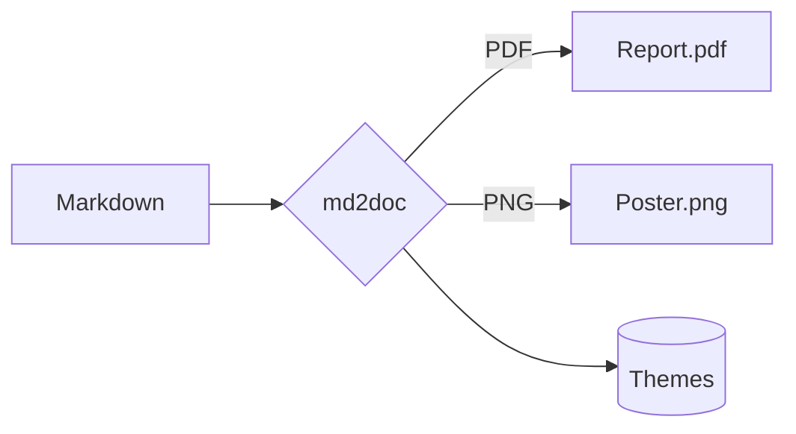
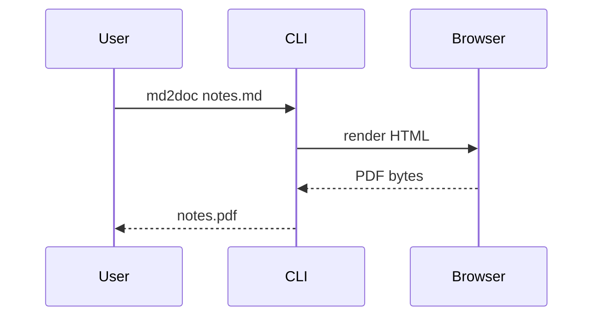
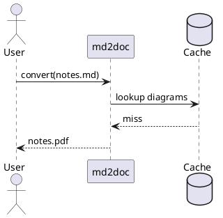

# Feature tour

This document exercises everything `md2doc` supports: **text**, *emphasis*, ~~strikethrough~~, `inline code`,
[links](https://example.com), footnotes[^1], task lists, tables, images, LaTeX, Mermaid and PlantUML.

## Math

Inline math such as $E = mc^2$ and $\alpha + \beta = \gamma$ sits in a sentence. Money like $5 and $10 is left alone.

Display math:

$$
\int_{-\infty}^{\infty} e^{-x^2}\,dx = \sqrt{\pi}
$$

An aligned system:

\begin{align}
  \nabla \cdot \mathbf{E} &= \frac{\rho}{\varepsilon_0} \\
  \nabla \times \mathbf{B} &= \mu_0 \mathbf{J} + \mu_0 \varepsilon_0 \frac{\partial \mathbf{E}}{\partial t}
\end{align}

Chemistry: $\ce{CO2 + H2O -> H2CO3}$

## Code

```python
def fibonacci(n: int) -> int:
    """Return the n-th Fibonacci number."""
    a, b = 0, 1
    for _ in range(n):
        a, b = b, a + b
    return a
```

## Tables and lists

| Feature   | PDF | PNG |
|-----------|:---:|:---:|
| Math      | yes | yes |
| Mermaid   | yes | yes |
| PlantUML  | yes | yes |

- [x] Markdown parsing
- [x] Themes and fonts
- [ ] World domination

> [!NOTE]
> GitHub-style alerts are supported, as are `!!! tip` admonitions.

!!! tip "Tip"
    Use `--theme nord` or `--accent "#e91e63"` to change the look.

## Images

{width=40%}

## Diagrams







[^1]: Footnotes are collected at the end of the document.
