# Mermaid gallery

## Flowchart
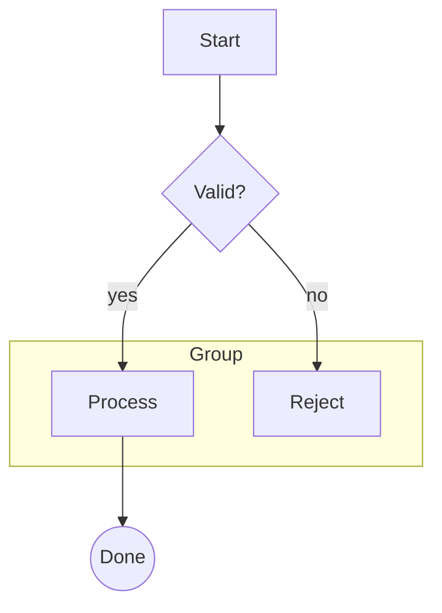

## Sequence
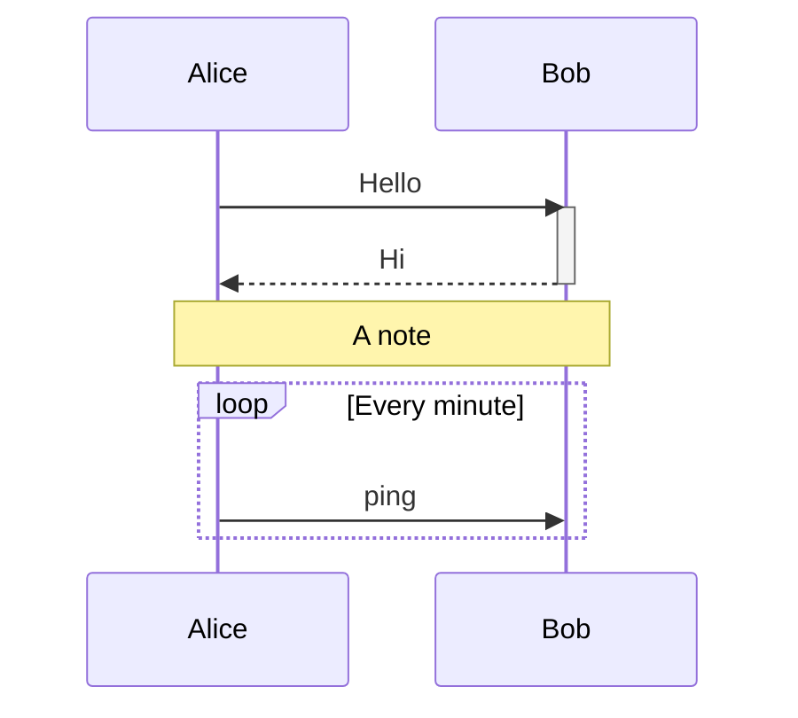

## Class
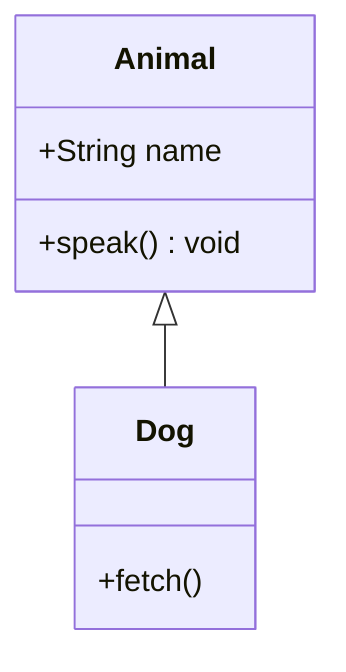

## State
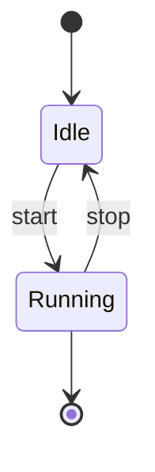

## ER
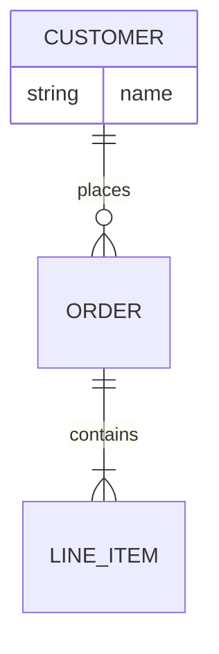

## Journey
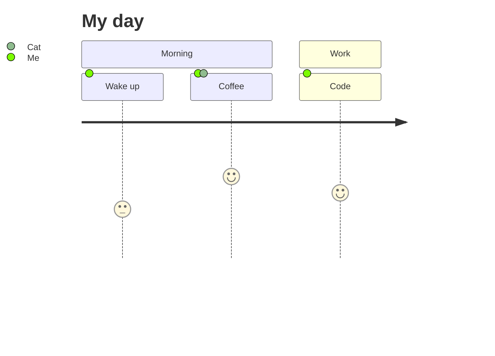

## Gantt
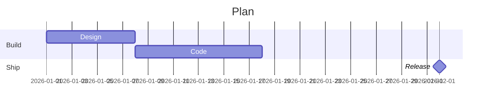

## Pie
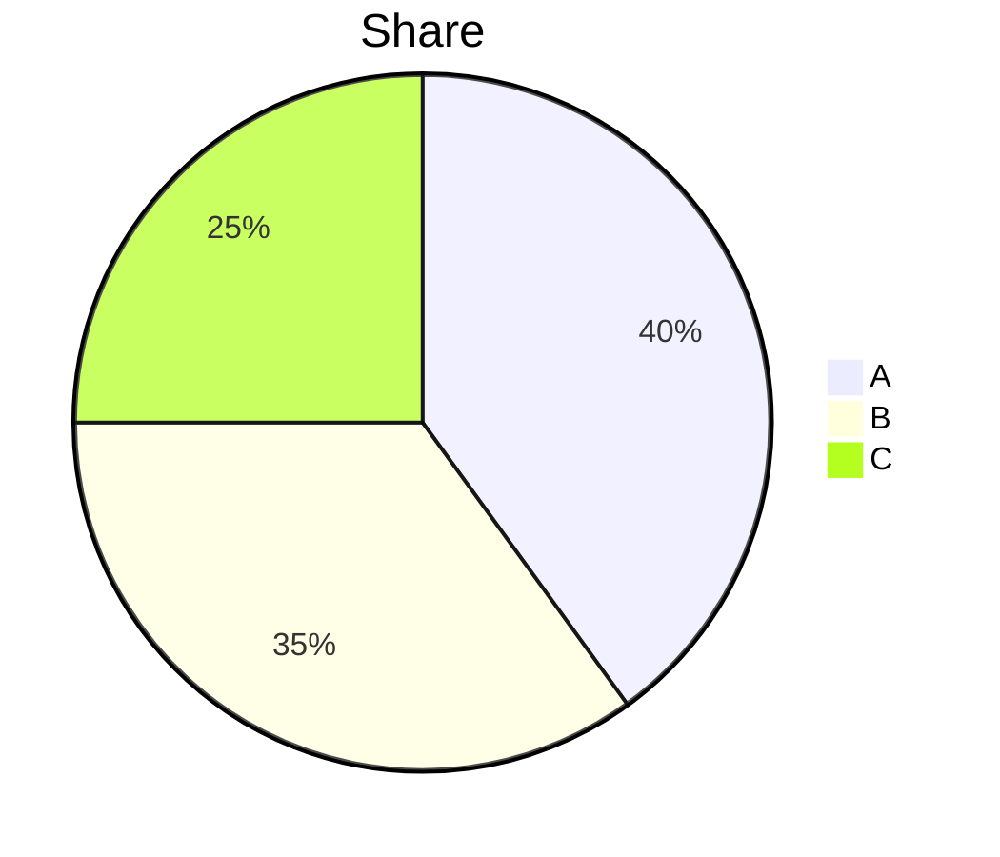

## Quadrant
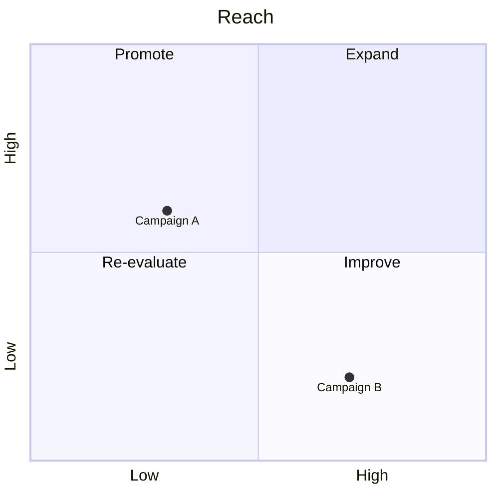

## Requirement
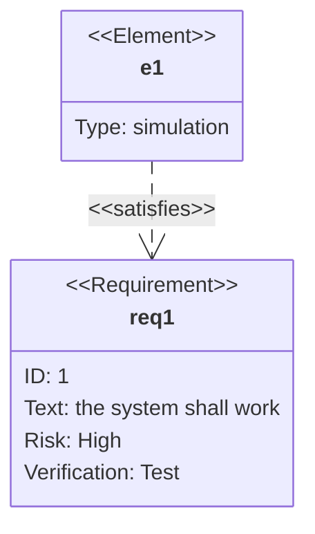

## Git graph
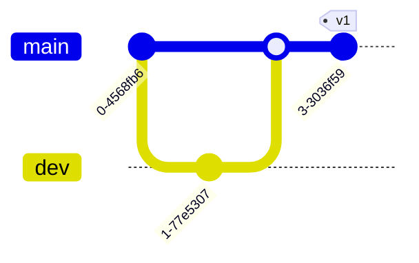

## Mindmap
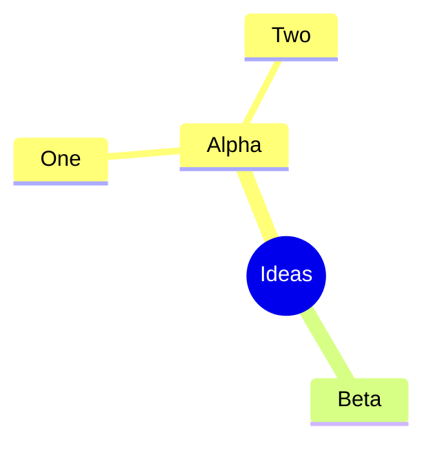

## Timeline
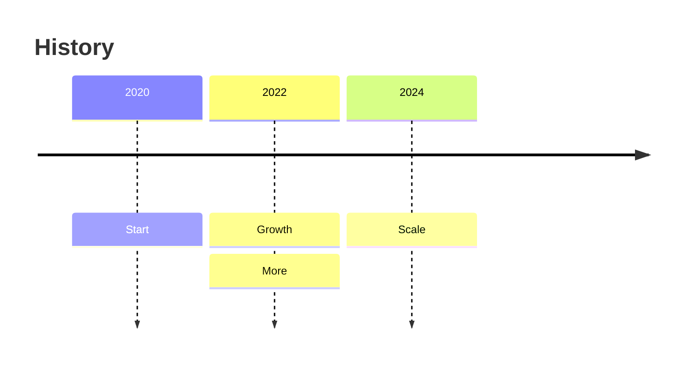

## Sankey
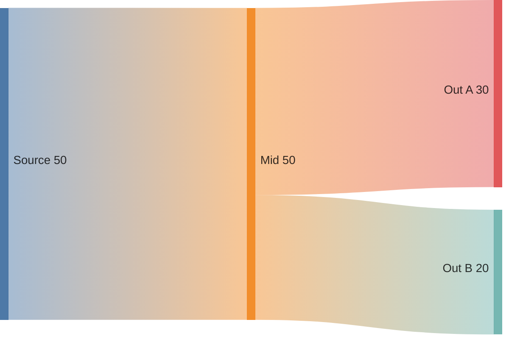

## XY chart
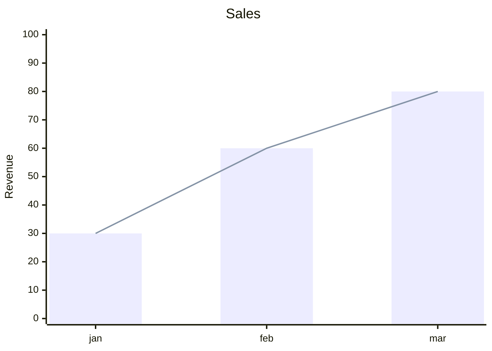

## Block
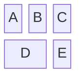

## Packet
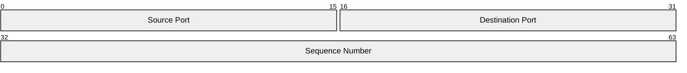

## Architecture
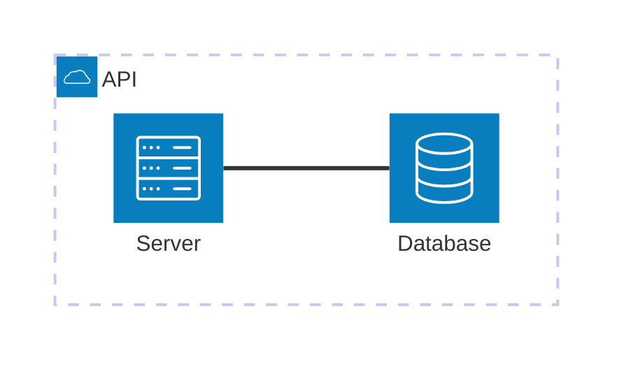

## Kanban
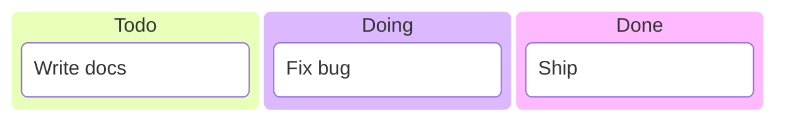
