# PlantUML gallery

## Sequence
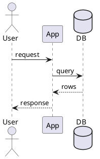

## Class
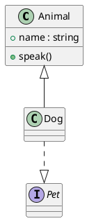

## Use case
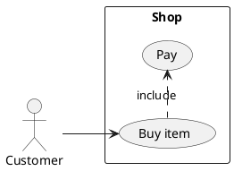

## Activity
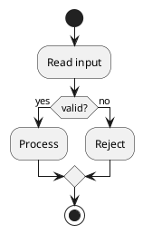

## Component
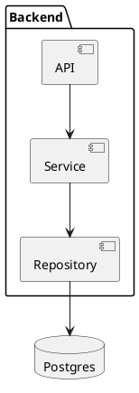

## State
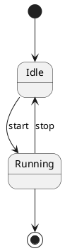

## Object
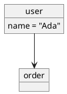

## Deployment
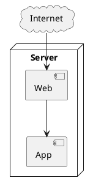

## Gantt
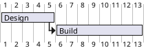

## Mindmap
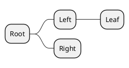

## WBS
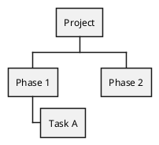

## JSON
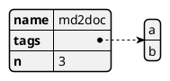

## Wireframe
```plantuml
@startsalt
{
  Login | "user   "
  Password | "****  "
  [Cancel] | [  OK  ]
}
@endsalt
```

## Skinparam by the author wins
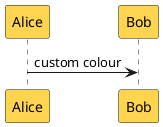
